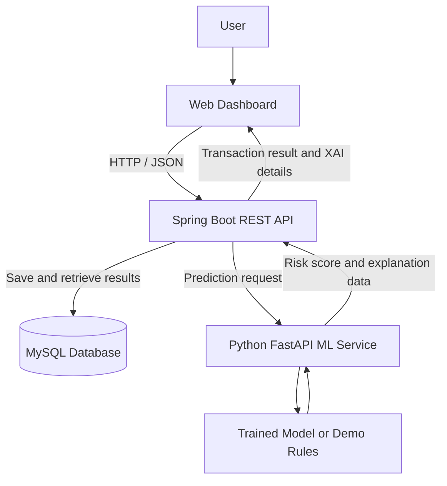

@'
# UPI Fraud Detection System with Explainable AI (XAI)

A full-stack portfolio project that evaluates simulated UPI-style transactions for potential fraud using a Java Spring Boot backend, MySQL persistence, and a Python machine-learning REST service. It includes a browser dashboard, transaction history, risk scoring, and explanations of factors that influence predictions.

> **Project scope:** This is an educational fraud-risk prototype. It does not connect to real UPI networks, banks, or payment accounts, and it does not initiate payments.

## Key Features

- **Transaction risk assessment:** Submit transaction details and receive a risk score and risk classification.
- **Full-stack architecture:** Java Spring Boot REST APIs, a Python FastAPI service, a MySQL database, and an HTML/CSS/JavaScript dashboard.
- **Machine-learning integration:** Calls a separate Python service to evaluate transaction risk.
- **Explainable AI (XAI):** Returns contributing factors, triggered rules, and model-level feature-importance information when supported.
- **Transaction history:** Saves transaction results and retrieves previously evaluated transactions.
- **Dashboard analytics:** Displays transaction totals and risk-category summaries.
- **Input validation and error handling:** Handles invalid requests and API errors.
- **Model training workflow:** Includes a Python script to compare four machine-learning algorithms on a labeled dataset.

## Technology Stack

| Layer | Technologies |
|---|---|
| Backend | Java 17, Spring Boot, Maven |
| Database | MySQL |
| ML service | Python 3.12, FastAPI, scikit-learn |
| Frontend | HTML, CSS, JavaScript |
| Communication | REST APIs, JSON |
| Testing | JUnit, Spring Boot Test |
| Development tools | VS Code, MySQL Workbench, Git |

## Architecture



The Java backend manages transaction requests, persistence, and communication with the Python service. The ML service evaluates transaction features and returns prediction and explanation data. The dashboard presents the results to the user.

## Prerequisites

Install or configure the following:

- Java Development Kit (JDK) 17 or later
- Maven, or use the project's Maven Wrapper if included
- MySQL Server and MySQL Workbench
- Python 3.12 (64-bit recommended)
- VS Code

Verify your installations:

```powershell
java -version
mvn -version
py -3.12 --version
```

If your system does not recognize `mvn`, use the Maven Wrapper commands where available.

## Setup and Run Locally

Run the backend and ML service in **two separate terminals**. Keep both terminals running while using the dashboard.

### 1. Clone the repository

```powershell
git clone https://github.com/AnilKumar-6/upi-fraud-detection-system.git
cd upi-fraud-detection-system
```

If you have already downloaded the project, open its root folder in VS Code instead.

### 2. Create the MySQL database

Start MySQL Server and open MySQL Workbench. Execute:

```sql
CREATE DATABASE upi_fraud_detection;
```

Configure the database username and password for your local MySQL installation. The application should use a database account with only the permissions it needs.

### 3. Configure and start Spring Boot

Open a terminal at the project root.

Set the database and ML-service connection details in PowerShell:

```powershell
$env:DB_URL="jdbc:mysql://localhost:3306/upi_fraud_detection"
$env:DB_USERNAME="root"
$env:DB_PASSWORD="YOUR_LOCAL_MYSQL_PASSWORD"
$env:ML_SERVICE_URL="http://localhost:8000"
```

Replace `YOUR_LOCAL_MYSQL_PASSWORD` with your local MySQL password. If your local MySQL account has no password, set `$env:DB_PASSWORD=""`.

Start the backend:

```powershell
mvn spring-boot:run
```

If Maven is not installed globally and the project wrapper is available, run:

```powershell
.\mvnw.cmd spring-boot:run
```

Backend URL: `http://localhost:8080`

Check the health endpoint:

```powershell
Invoke-RestMethod http://localhost:8080/api/health
```

### 4. Install and start the Python ML service

Open a **second terminal** at the project root:

```powershell
cd ml-service
py -3.12 -m venv .venv
.\.venv\Scripts\python.exe -m pip install --upgrade pip
.\.venv\Scripts\python.exe -m pip install -r requirements.txt
```

Start the service:

```powershell
.\.venv\Scripts\python.exe -m uvicorn app:app --host 127.0.0.1 --port 8000
```

ML service URL: `http://127.0.0.1:8000`

Check its health:

```powershell
Invoke-RestMethod http://127.0.0.1:8000/health
```

The health response indicates whether the service is up and whether a trained model is loaded. Follow the reported mode rather than assuming every prediction uses a trained model.

### 5. Open the dashboard

With both services running, open:

**http://localhost:8080**

Use the dashboard to submit a transaction, inspect the risk result, review explanation details, and browse saved transaction history.

## REST API

The main Spring Boot endpoints are:

| Method | Endpoint | Purpose |
|---|---|---|
| `GET` | `/api/health` | Check backend health |
| `POST` | `/api/transactions` | Evaluate and save a transaction |
| `GET` | `/api/transactions` | Retrieve transaction history |
| `GET` | `/api/transactions/{id}` | Retrieve a transaction by ID |
| `GET` | `/api/dashboard/summary` | Retrieve dashboard summary statistics |

The Python service also exposes `/health` for service status. Prediction and feature-importance endpoints are implemented by the ML service.

### Example transaction request

```json
{
  "senderUpi": "anil@upi",
  "receiverUpi": "shop@upi",
  "amount": 1500.00,
  "transactionType": "P2P",
  "hourOfDay": 22,
  "locationMismatch": false,
  "failedAttempts": 0,
  "deviceChanged": false
}
```

Submit the JSON body to `POST /api/transactions` with the `Content-Type: application/json` header. The backend evaluates the request through the configured service, saves the result, and returns the transaction details.

## Explainable AI

The project includes several ways to inspect a prediction:

- **Contributing factors:** Shows transaction features and their estimated influence on the individual prediction.
- **Rule triggers:** Identifies risk rules activated by transaction attributes.
- **Model-level feature importance:** Reports feature importance when the selected model supports it.
- **Risk metadata:** Includes the risk classification, score, and prediction-source information.

**Interpretation note:** The local explanation uses a single-feature ablation/sensitivity approximation. It is not SHAP, does not establish causation, and does not prove that a particular feature caused fraud. Rule scores and model scores are different signals and should not be interpreted as calibrated probabilities unless calibration has been independently established.

## Model Training

The `ml-service/train_model.py` script supports an optional training workflow using a labeled CSV dataset. It compares:

- Decision Tree
- Random Forest
- Gradient Boosting
- Support Vector Machine (SVM)

The script reports accuracy, precision, recall, F1, and ROC-AUC on a held-out split and saves a trained pipeline.

Expected CSV columns:

```text
amount,hourOfDay,locationMismatch,failedAttempts,deviceChanged,transactionType,is_fraud
```

The `is_fraud` column must contain labels `0` and `1`, and the training data must include both classes.

From the `ml-service` directory, after installing the requirements and creating the virtual environment:

```powershell
.\.venv\Scripts\python.exe train_model.py --csv .\your_labeled_dataset.csv
```

Replace `your_labeled_dataset.csv` with the path to your authorized, appropriately labeled dataset.

**Data limitation:** PaySim is a synthetic mobile-money dataset, not a real UPI dataset. The original source report did not include an available original Python source/model. Therefore, this repository provides a modernized implementation and a training workflow rather than claiming to reproduce an unavailable original model. Use the ML service's health response to confirm which prediction mode is active.

## Run Tests

From the project root:

```powershell
mvn test
```

The current test suite covers transaction-controller behavior and transaction-request validation. Integration testing against a dedicated test database and the ML service can be added as further work.

## Security and Production Considerations

This project is a portfolio prototype, not a production-ready financial fraud platform. Before real-world deployment, it would require:

- Authentication and role-based authorization
- Secure secrets management and restricted database permissions
- Independent model evaluation on representative, authorized data
- Validation of thresholds, calibration, false-positive rates, and false-negative rates
- Monitoring for model drift, audit logging, and analyst review
- Integration tests and security testing
- Approved integrations with financial systems, where applicable

Do not use the output as the sole basis for real financial decisions.

## Future Enhancements

- Authentication and role-based access control
- Pagination and advanced transaction filters
- Model-version metadata and validation-based risk thresholds
- Model-drift monitoring and audit trails
- Integration tests using a dedicated test database or Testcontainers
- Deployment with secure configuration and monitoring

## Author

**Anil Kumar**

Java | Spring Boot | MySQL | Python | REST APIs | Machine Learning

---

Never commit database passwords, API keys, access tokens, or other secrets to GitHub.
'@ | Set-Content -Path ".\README.md" -Encoding utf8

git diff --check
git status
